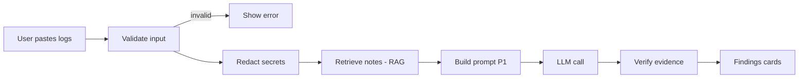
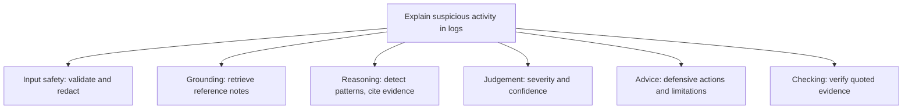
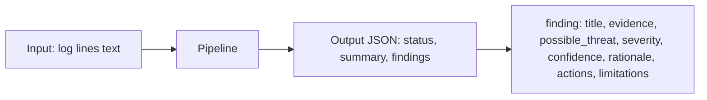
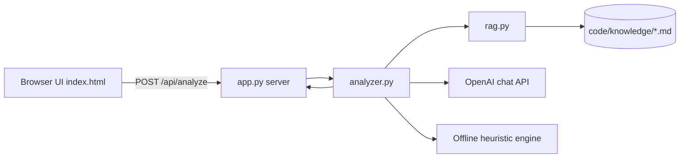
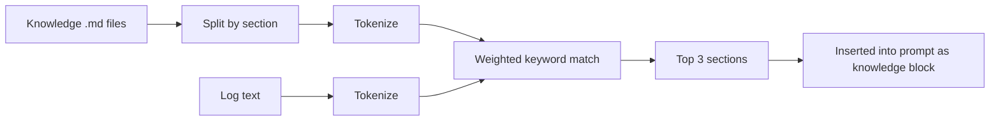

# Architecture and prompt design

Mermaid diagrams (render on GitHub, or paste into https://mermaid.live). Redraw them in your own style for the PDF and make sure they match what you built.

## 1. Prompt workflow

## 2. Task decomposition

## 3. Input-output flow

## 4. System architecture

## 5. RAG pipeline

## Final prompt count

This scaffold has **1 final prompt**: P1 (log analysis), split into a system file and a user template. If you add more prompts, update the count (form Q10) and add one prompt sheet per prompt to the PDF.
